# ECHO 软件项目流程图

> 快照日期：2026-10-17
> 稳定基线：`main` / `v0.0.255` / commit `5b33b7d`
> 配套文档：[`项目切片.md`](项目切片.md)
> 说明：本文件集中描述系统拓扑、请求生命周期、教师端流程、学生端流程、RAG、知识图谱、学习证据、审核、策略和执行计划。项目切片、职责边界和比赛口径放在《项目切片》中。

## 1. 阅读方式

流程图使用三类边界：

| 线条 | 含义 |
| --- | --- |
| 实线 | 正常业务调用或数据流 |
| 虚线 | 禁止直连、非稳定能力或边界说明 |
| 决策节点 | 条件、状态或教师动作 |

当前是单体 FastAPI 后端加教师 Web、学生 App 的单仓架构，不是微服务。

## 2. 整体系统拓扑

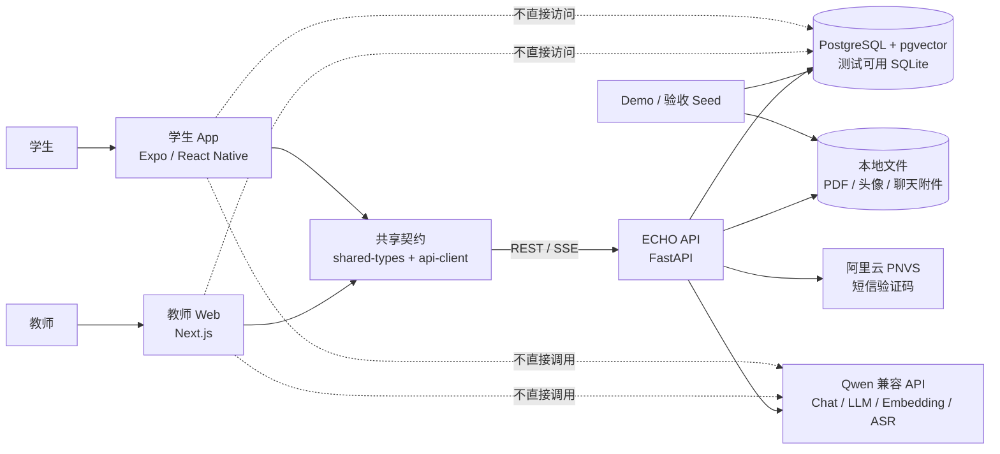

图中术语：

- `API`：后端对外提供的程序接口，前端通过它读写业务数据。
- `REST`：一种常见的 HTTP 接口风格，图中负责普通 JSON 请求。
- `SSE`：Server-Sent Events，服务器单向持续推送事件，图中负责流式回答。
- `pgvector`：PostgreSQL 的向量扩展，用于保存和检索 Chunk Embedding。
- `SQLite`：轻量本地数据库，图中的测试和开发降级路径。
- `Qwen`：通义千问模型服务，图中负责回答、Embedding、结构生成和 ASR。
- `ASR`：Automatic Speech Recognition，自动语音识别。
- `Seed`：可重复生成的预置演示或验收数据。

核心边界：

- 教师端和学生端只通过共享类型与 API Client 访问后端。
- 前端不直接读写数据库，不直接调用 Qwen，不持有模型 API Key。
- 后端统一负责认证、课程归属、角色权限、事务和外部服务调用。

## 3. 项目主闭环

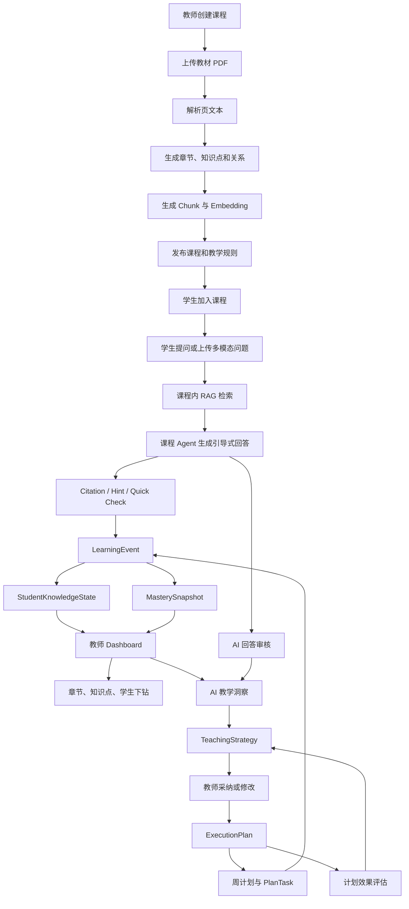

图中术语：

- `RAG`：Retrieval-Augmented Generation，先检索课程材料，再让模型生成回答。
- `Citation`：回答引用记录，用于回到教材文档、页码或原文片段。
- `LearningEvent`：学习行为事件，例如提问、请求提示、答题正确或错误。
- `StudentKnowledgeState`：学生当前的知识掌握状态。
- `MasterySnapshot`：某个时间点的掌握度快照，用于查看历史趋势。
- `TeachingStrategy`：教学策略对象，初始状态只是 AI 建议。
- `ExecutionPlan`：教学执行计划，负责把策略拆成周计划和任务。
- `PlanTask`：执行计划中的具体教学任务。

闭环中心是 `LearningEvent`。对话只是产生学习证据的入口之一。

## 4. 仓库与模块依赖

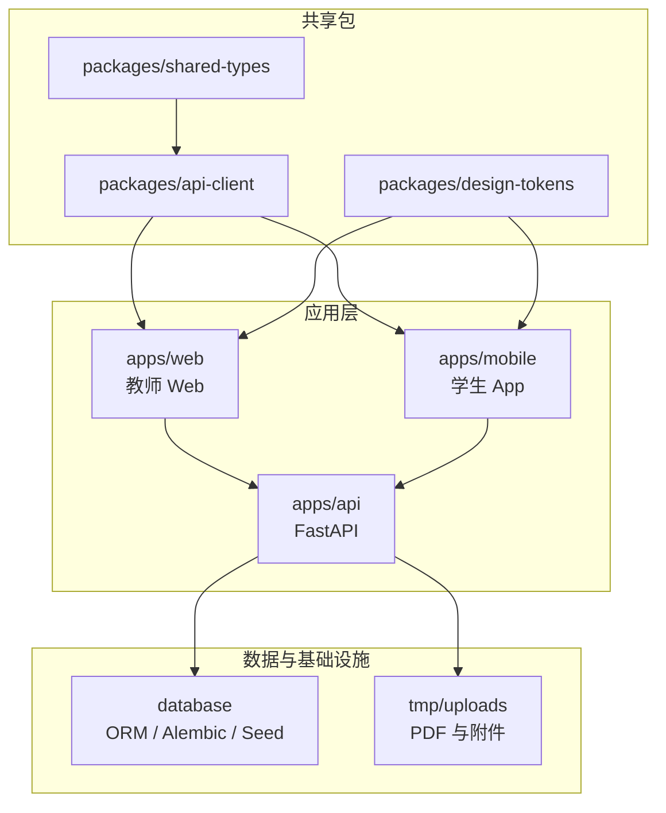

图中术语：

- `Monorepo`：一个仓库中同时维护教师端、学生端、后端和共享包。
- `shared-types`：前后端共享的 TypeScript 类型定义。
- `api-client`：前端统一访问后端 REST 和 SSE 的客户端。
- `design-tokens`：颜色、圆角、间距和动效等设计变量。
- `ORM`：Object Relational Mapping，用代码对象读写数据库表。
- `Alembic`：Python 数据库迁移工具，用于升级或回退表结构。

## 5. 后端请求生命周期

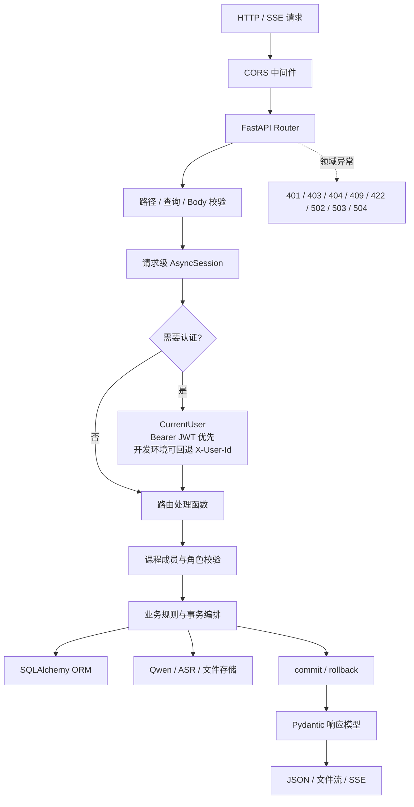

图中术语：

- `HTTP`：浏览器和服务器之间的请求协议。
- `CORS`：Cross-Origin Resource Sharing，跨域资源访问控制。
- `Router`：按业务领域注册 API 路径的后端路由层。
- `AsyncSession`：SQLAlchemy 的异步数据库会话。
- `CurrentUser`：从登录凭证解析出的当前用户。
- `JWT`：JSON Web Token，一种带签名的访问令牌。
- `X-User-Id`：开发环境用于模拟用户的请求头，生产环境必须关闭。
- `Pydantic`：后端请求和响应数据校验与序列化工具。
- `commit / rollback`：提交或撤销当前数据库事务。

Router 主要按领域挂载：

```text
analysis, announcements, auth, chat, chunks, courses, dashboard,
dashboard_details, demo, documents, knowledge_graph_embed, knowledge,
learning, notifications, planning, review, quick_check, search,
student_resources, system, teaching_policy, teacher_resources,
teacher_assistant, users, health
```

## 6. 教师端主流程

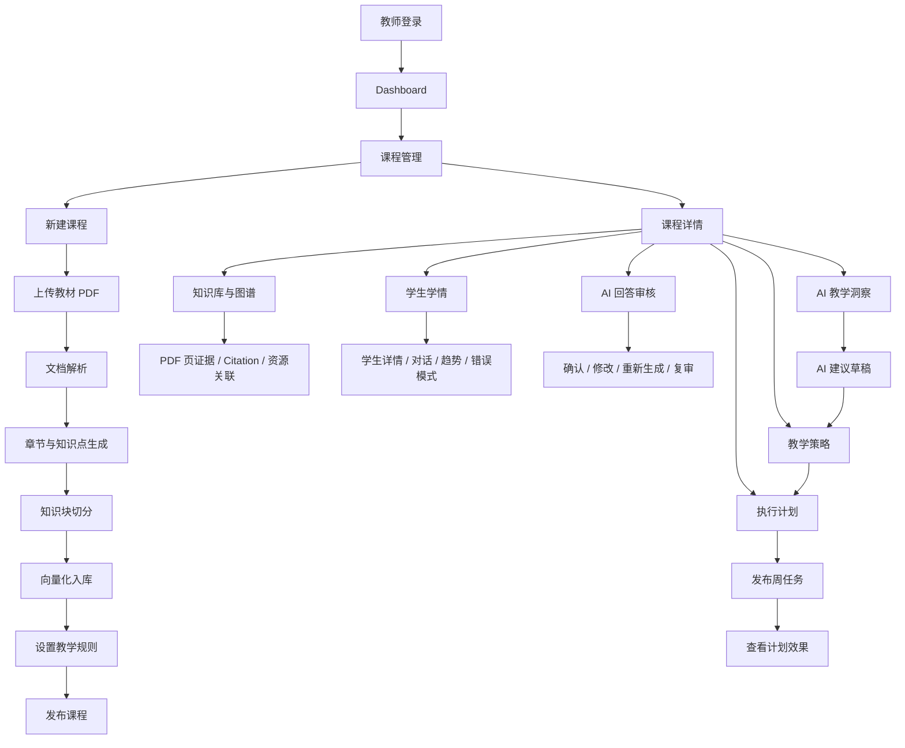

图中术语：

- `Dashboard`：教师教学总览页。
- `Citation`：回答所引用的教材证据。
- `ReviewDecision`：教师对 AI 回答作出的确认、修改、忽略或重新生成决定。
- `StrategyDraft`：AI 生成但尚未被教师采纳的策略草稿。

教师端主路由：

```text
/dashboard
/courses
/courses/new
/courses/{courseId}
/knowledge
/knowledge/points/{knowledgePointId}
/knowledge/resources/{resourceId}
/students
/students/{studentId}
/students/{studentId}/conversations/{conversationId}
/ai-review
/ai-review/pending
/ai-insights
/teaching-strategies
/teaching-strategies/{strategyId}
/execution-plans/new
/execution-plans/{planId}
/settings/server
/settings/demo
/me
```

## 7. 学生端主流程

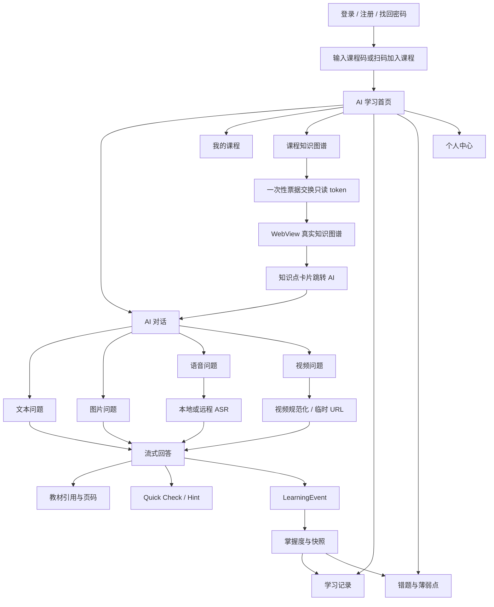

图中术语：

- `ASR`：自动语音识别，把语音内容转换成文本。
- `LearningEvent`：学生在学习过程中产生的行为事件。
- `Mastery`：系统根据学习事件计算的掌握状态。
- `EmbedAuth`：学生端进入图谱前的一次性授权交换。
- `Token`：短期有效、用于访问受保护资源的凭证。
- `WebView`：App 内嵌的网页视图，用于展示教师端同一套图谱。
- `Quick Check`：快速检测，用于验证学生是否真正理解当前知识点。
- `Hint`：分层提示，不直接替代学生完成回答。

学生端主路由：

```text
/login
/register
/forgot-password
/reset-password
/join-course
/(tabs)/ai
/(tabs)/courses
/(tabs)/me
/courses/{courseId}
/courses/{courseId}/chapters/{chapterId}
/knowledge/{knowledgePointId}
/knowledge-graph
/chat
/learning-records
/wrong-questions
/change-password
/network-settings
```

## 8. 建课、解析与 RAG 流水线

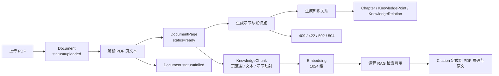

图中术语：

- `Document`：教材或资料的元数据记录。
- `DocumentPage`：从 PDF 中提取出的单页文本。
- `KnowledgeChunk`：从页面文本切出的可检索文本块。
- `Embedding`：把文本转换成固定长度的数值向量。
- `1024 维`：每个 Embedding 向量包含 1024 个数值。
- `RAG`：先检索课程文本块，再把检索结果交给模型生成回答。
- `Citation`：回答所引用的教材证据记录。
- `uploaded / ready / failed`：文档已上传、可检索、解析失败三个状态。

当前教师课程向导按四条请求串行执行：

```text
POST /documents/{document_id}/parse
POST /documents/{document_id}/generate-structure
POST /documents/{document_id}/chunks
POST /documents/{document_id}/embeddings
```

## 9. 章节、知识点与关系生成

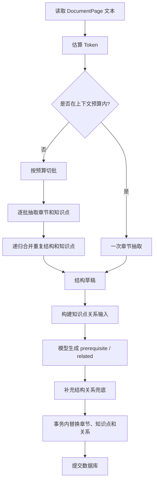

图中术语：

- `Token`：模型上下文长度单位，不等同于登录 Token。
- `LLM`：Large Language Model，大语言模型。
- `prerequisite`：前置知识关系，表示先学什么再学什么。
- `related`：相关知识关系，表示知识点之间存在语义关联。
- `递归合并`：分批生成后反复合并重复章节和知识点。
- `Fallback`：模型关系生成失败时的结构关系兜底。
- `事务`：一组要么全部成功、要么全部回滚的数据库操作。

规则：

- 章节和知识点来自模型输出与教材文本。
- 关系类型只保留 `prerequisite` 与 `related` 的标准投影。
- 生成失败不能写半套结构，事务失败需要回滚。
- 同一文档的结构生成会替换旧结构，并维护知识点关联数据。

## 10. 知识图谱流程

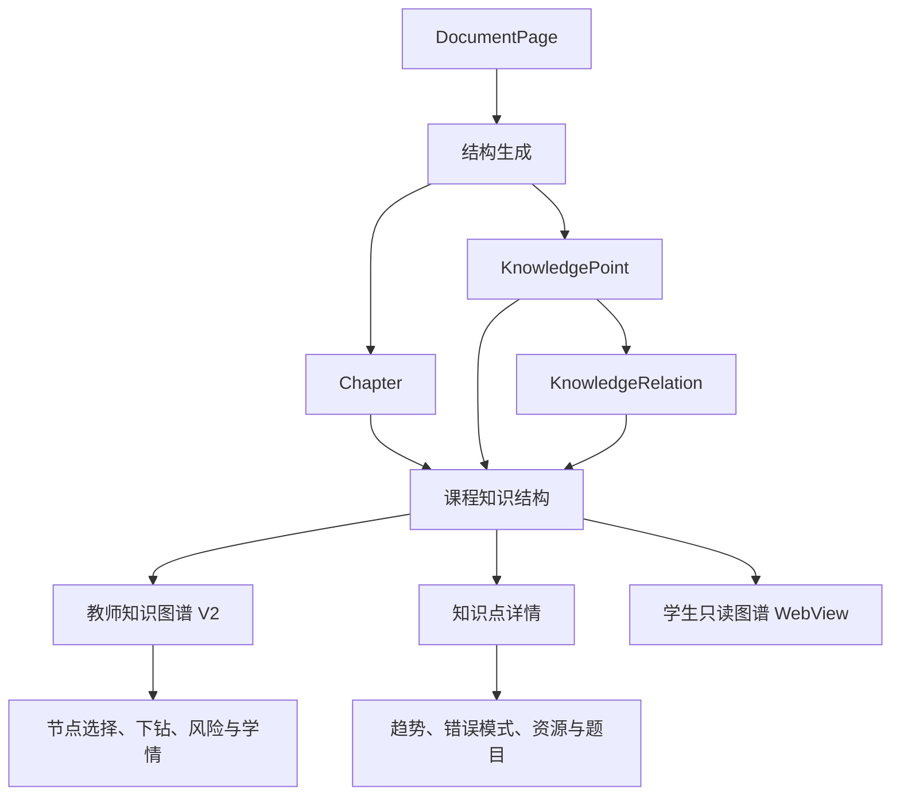

图中术语：

- `Chapter`：课程章节。
- `KnowledgePoint`：课程知识点。
- `KnowledgeRelation`：知识点之间的持久关系。
- `Graph V2`：当前教师 Web 使用的知识图谱实现版本。
- `prerequisite`：前置知识关系。
- `related`：相关知识关系。
- `只读图谱`：学生可以查看和跳转，但不能修改节点或关系。

图谱切片边界：

- 节点必须来自真实课程结构和关系。
- `prerequisite` 与 `related` 不能被混为同一种强语义。
- 学生端只读，不能修改图谱。
- 未提交图谱实验不属于当前稳定基线。

## 11. 学生 AI 问答与 Agent 决策链

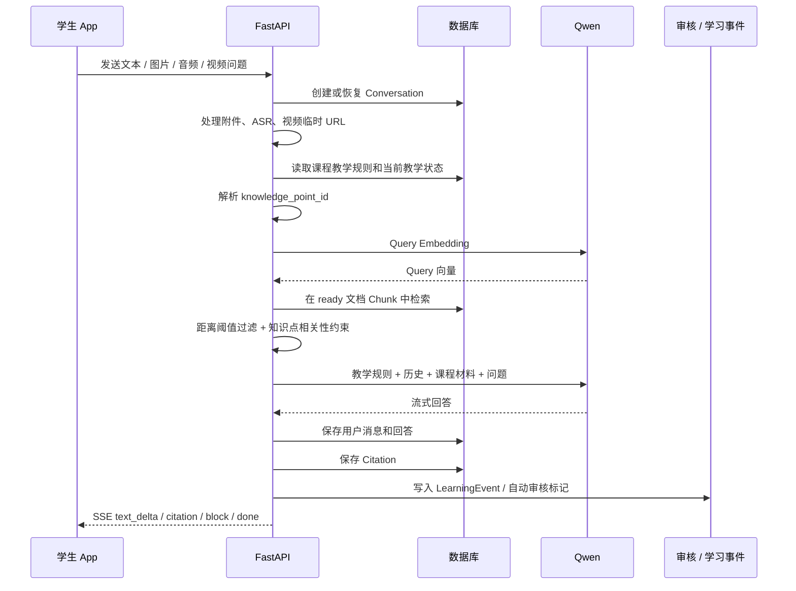

图中术语：

- `Conversation`：一次持续会话的容器。
- `Query Embedding`：把学生问题转换成的检索向量。
- `Chunk`：用于 RAG 检索的教材文本块。
- `阈值过滤`：只保留相似度达到要求的检索结果。
- `knowledge_point_id`：知识点唯一标识，用于限制问答上下文。
- `Citation`：本次回答实际使用的教材引用。
- `LearningEvent`：本次学习行为生成的事件。
- `SSE`：Server-Sent Events，服务器持续推送回答片段和结构化块。

Agent 约束：

- 教学规则影响回答语气、步骤和提示层级。
- RAG 为空或超出距离阈值时，回答不能伪造教材引用。
- 只有显式携带有效 `knowledge_point_id`，且问题与知识点相关时，才生成知识点问答卡片、Hint 和 Quick Check。
- 教师会话不会生成学生问题审核项。
- 学生、会话、消息、知识点和课程归属必须一致。

## 12. 多模态输入处理

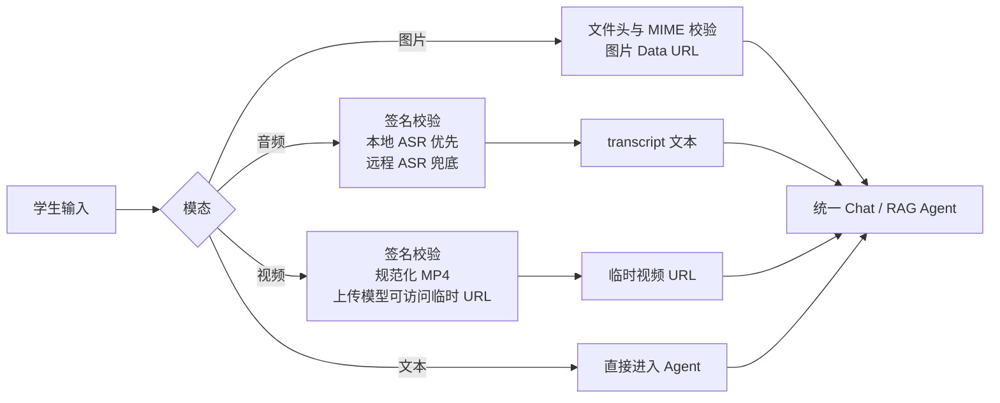

图中术语：

- `MIME`：文件媒体类型，例如图片、音频或视频的格式标识。
- `Data URL`：把图片等小文件内容直接编码进请求数据中。
- `ASR`：自动语音识别。
- `MP4`：一种常见视频容器格式。
- `transcript`：音频识别后得到的文字稿。
- `临时 URL`：短时间有效、允许模型服务读取视频的地址。

## 13. 学习事件、掌握度和教师干预

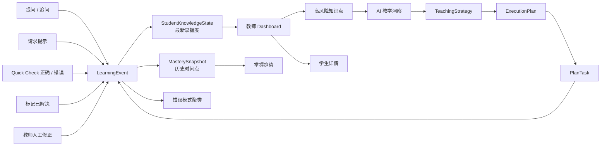

图中术语：

- `LearningEvent`：提问、提示、答题、错误和解决等学习行为事实。
- `StudentKnowledgeState`：学生当前的最新掌握状态。
- `MasterySnapshot`：历史时间点上的掌握度快照。
- `Dashboard`：教师用于查看课程学情的总览页面。
- `错误模式`：对重复错误或相似困难事件的聚合。
- `TeachingStrategy`：由 AI 建议或教师创建的教学策略。
- `ExecutionPlan`：用于落实策略的周期计划。
- `PlanTask`：计划中的具体教学任务。

## 14. 教师学情与证据下钻

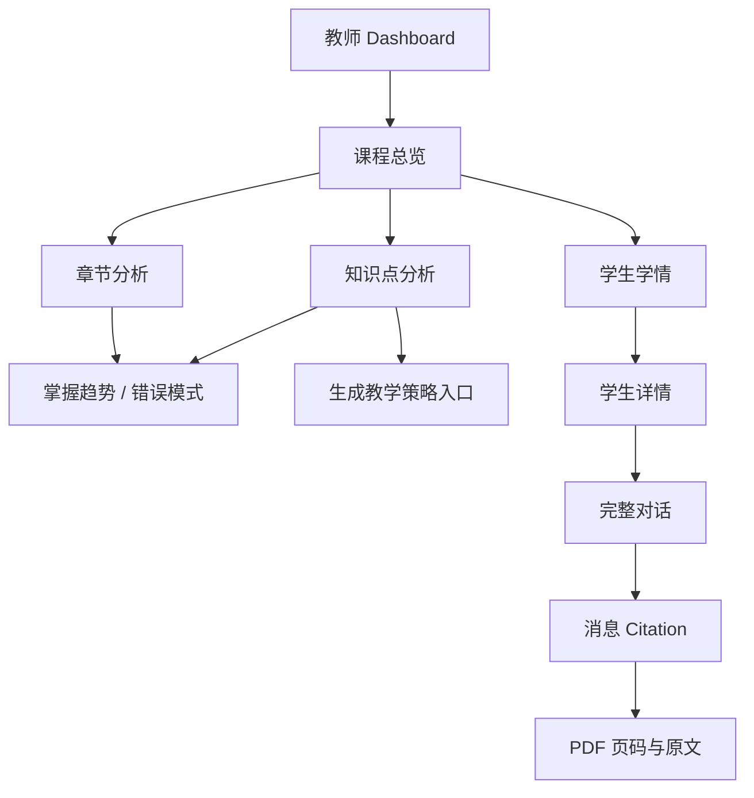

图中术语：

- `Dashboard`：教师教学总览。
- `章节分析`：按章节聚合掌握度、事件和困难。
- `知识点分析`：围绕单个知识点查看趋势、错误和证据。
- `Citation`：回答使用的教材引用。
- `PDF 页码`：引用对应的教材页面位置。

下钻路径：

```text
课程
-> 章节
-> 知识点
-> 学生
-> 学习事件
-> 原始对话
-> 教材引用
-> PDF 页面
```

## 15. AI 回答审核闭环

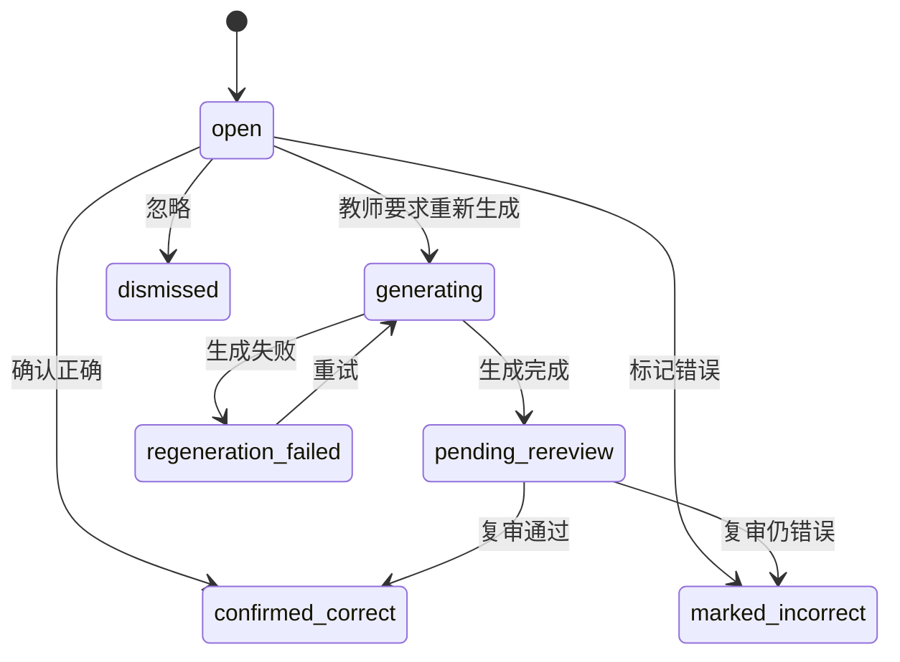

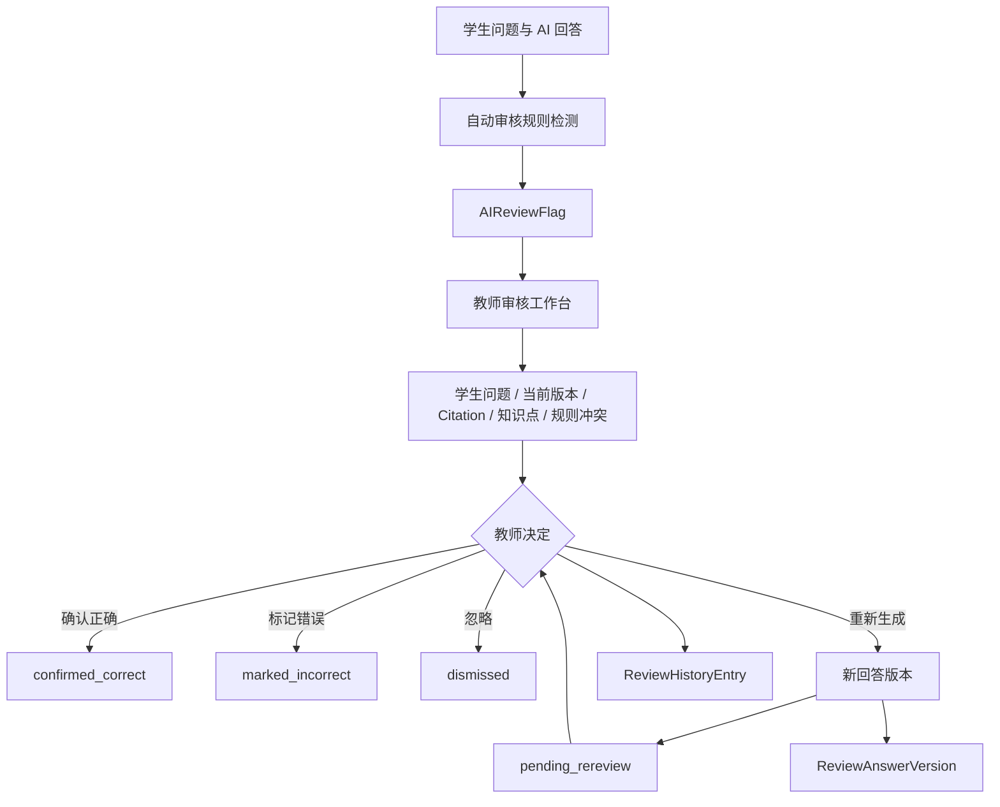

图中术语：

- `AIReviewFlag`：系统自动生成的 AI 回答审核标记。
- `open`：等待教师首次审核。
- `generating`：正在重新生成新版本。
- `pending_rereview`：生成完成，等待教师再次审核。
- `regeneration_failed`：重新生成失败。
- `confirmed_correct`：教师确认回答正确。
- `marked_incorrect`：教师标记回答错误。
- `dismissed`：教师认为风险可以忽略。
- `ReviewAnswerVersion`：每次原始回答、模型重生成或教师修改形成的版本。
- `ReviewHistoryEntry`：审核动作和状态变化记录。

## 16. AI 洞察、策略、计划与效果

```mermaid
flowchart LR
    Evidence["课程证据<br/>LearningEvent / Mastery / Conversation / Review"] --> Analysis["AI 二次分析"]
    Analysis --> Stages["五阶段进度<br/>collecting -> querying -> expanding -> analyzing -> generating"]
    Stages --> Result["分析结果与建议"]

    Result --> Strategy["TeachingStrategy<br/>初始 suggested"]
    Strategy --> Adopt{"教师动作"}
    Adopt -->|"采纳"| Active["active"]
    Adopt -->|"编辑"| Version["策略版本"]
    Active --> Plan["ExecutionPlan<br/>初始 draft"]
    Plan --> Generate["生成周计划与任务"]
    Generate --> Publish["教师发布"]
    Publish --> Tasks["学生执行 PlanTask"]
    Tasks --> Events["计划关联 LearningEvent"]
    Events --> Effect["计划 / 策略效果评估"]
```

图中术语：

- `五阶段进度`：收集证据、查询、扩展、分析、生成五个分析阶段。
- `suggested`：AI 生成但尚未被教师采纳的策略状态。
- `active`：已经被教师启用或执行中的策略状态。
- `draft`：执行计划的初始草稿状态。
- `PlanTask`：计划中的具体教学任务。
- `LearningEvent`：执行计划产生或关联的学习行为事件。
- `效果评估`：对比执行前后事实、任务完成情况和剩余问题。

AI 结果不得直接发布。发布、采纳、暂停、继续、完成都必须由教师操作触发。

## 17. 教师知识助手

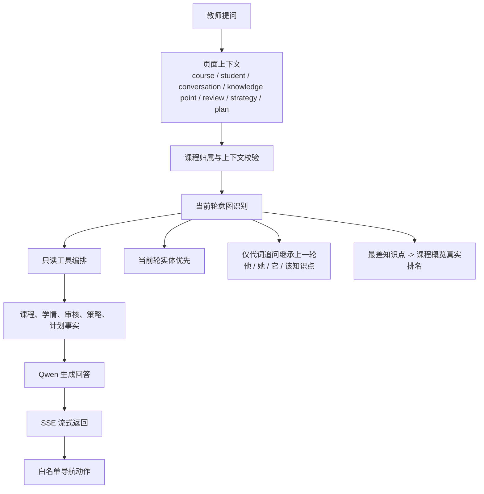

图中术语：

- `Context`：当前页面携带的课程、学生、知识点、审核或计划上下文。
- `Intent`：对教师当前问题意图的识别结果。
- `只读工具编排`：只查询事实，不修改课程或教学数据。
- `SSE`：服务器持续推送回答片段。
- `白名单导航动作`：只允许跳转到预先登记的安全页面。

安全边界：

- 教师助手只读，不修改课程、学情、审核、策略或计划。
- 历史消息不得污染新问题实体。
- 学生、教材和工具输出都视为不可信数据。
- 页面跳转只从结构化白名单动作生成。

## 18. 认证、短信和会话

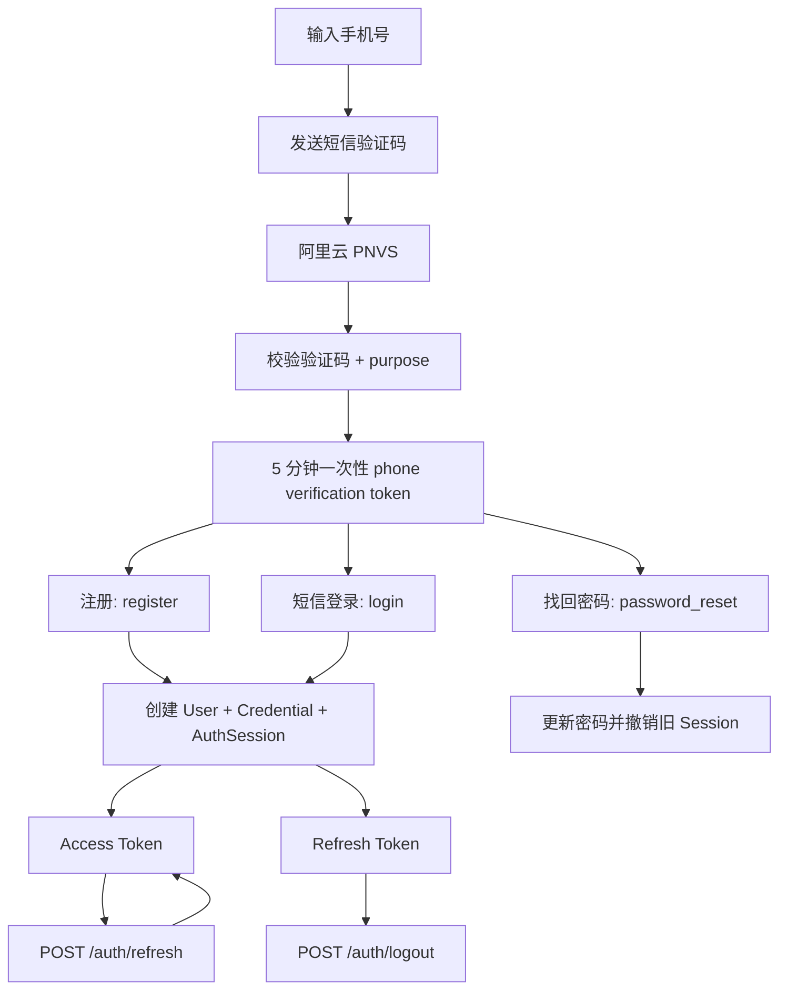

图中术语：

- `PNVS`：阿里云短信验证码服务。
- `purpose`：验证码用途，例如注册、登录或重置密码。
- `phone verification token`：验证码校验通过后签发的短期身份凭证。
- `Access Token`：访问业务接口使用的短期令牌。
- `Refresh Token`：Access Token 过期后用于续期的长效令牌。
- `AuthSession`：服务端保存的登录会话记录。

开发环境可以回退 `X-User-Id`，生产环境必须关闭开发认证。

## 19. Demo、Seed 与运行检查

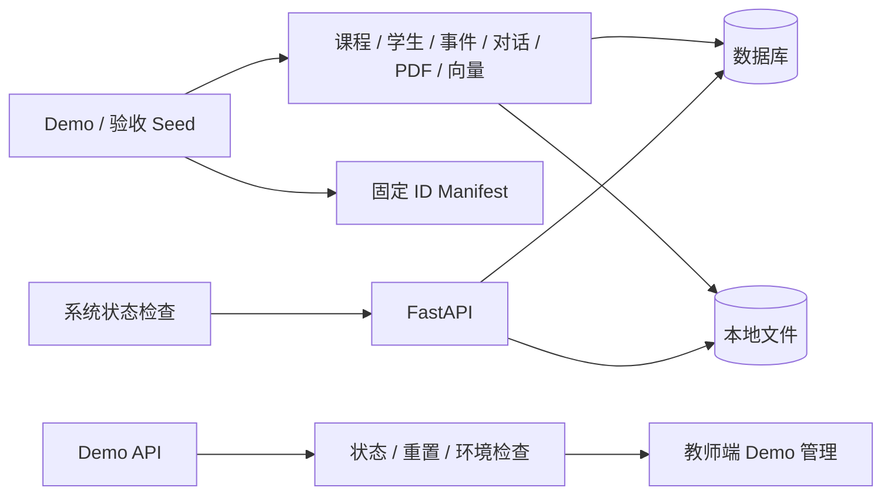

图中术语：

- `Seed`：可重复生成的预置数据。
- `Manifest`：固定记录 Demo 课程、学生、策略和计划 ID 的清单。
- `Demo API`：用于查看、重置和检查 Demo 数据的后端接口。
- `系统状态检查`：检查数据库、文件、模型配置和网络等运行条件。

现场演示原则：

- 优先使用预置课程和固定实体 ID。
- 演示前完成 PDF、结构和向量准备。
- 每个关键功能都有独立截图或录屏回退。
- Seed、Demo 和真实数据必须明确区分。
- 效果不足时显示证据不足，不补写虚假结果。

## 20. 后台维护任务

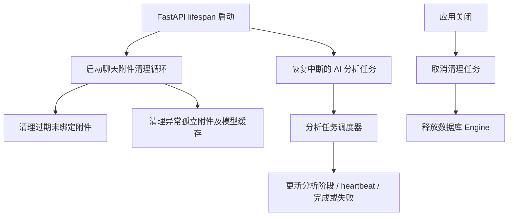

图中术语：

- `lifespan`：FastAPI 应用启动和关闭时执行的生命周期逻辑。
- `heartbeat`：异步任务持续上报的进度心跳。
- `Scheduler`：后端进程内负责推进 AI 分析任务的调度器。
- `孤立附件`：没有成功绑定到消息、又超过保留时间的临时附件。
- `Engine`：SQLAlchemy 管理数据库连接池的核心对象。

## 21. 状态生命周期

| 领域 | 状态 |
| --- | --- |
| 课程 | `draft -> published -> archived`，归档后可恢复为草稿 |
| 文档 | `uploaded -> parsing -> ready`，解析失败为 `failed` |
| 消息 | `streaming / complete / interrupted / failed` |
| 审核 | `open / generating / pending_rereview / regeneration_failed / confirmed_correct / marked_incorrect / dismissed` |
| AI 分析 | `analyzing / completed / failed` |
| 教学策略 | `suggested / accepted / planned / active / paused / completed / dismissed` |
| 执行计划 | `draft / ready / active / paused / completed / cancelled` |
| 计划任务 | `not_started / in_progress / completed / overdue / cancelled` |
| 学习事件 | `question_asked / hint_requested / quiz_correct / quiz_wrong / concept_confusion / repeated_error / resolved / teacher_adjustment` |

## 22. 当前架构边界

- 当前是单体 FastAPI 加两个前端的单仓架构，不是微服务。
- 教材解析、章节识别、切块和向量化仍是串行 HTTP 请求，尚未改成完整异步任务流水线。
- AI 二次分析使用异步任务和阶段轮询。
- Qwen Chat、Embedding、结构生成和 ASR 由后端统一调用。
- 文件当前是本地存储，生产化仍需要对象存储、独立任务队列和更严格的可观测性。
- PostgreSQL + pgvector 是正式目标，SQLite 是开发和测试降级路径。
- 共享契约是跨端唯一网络边界，前端页面不得自行拼接未登记接口或创建第二套类型。
